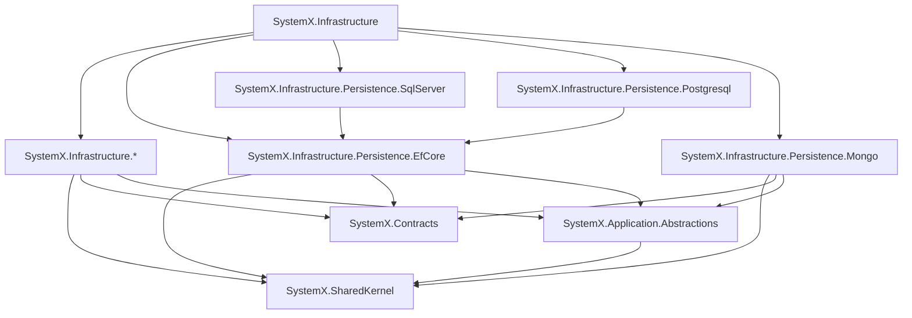

# SystemX.Nuget

Reusable building blocks and modular infrastructure libraries for .NET applications.

For architectural layering and package reference restrictions, refer to [AGENTS.md](AGENTS.md).

## 1. Overview and Packages

| Package | Description | Installation |
|---|---|---|
| `SystemX.SharedKernel` | Core domain primitives, Entity, ValueObject, Result, Guards, Clock | `dotnet add package SystemX.SharedKernel` |
| `SystemX.Contracts` | Common DTOs, requests/responses, integration events | `dotnet add package SystemX.Contracts` |
| `SystemX.Application.Abstractions` | CQRS, Unit of Work, and repository abstractions | `dotnet add package SystemX.Application.Abstractions` |
| `SystemX.Infrastructure` | Metapackage aggregating infrastructure components | `dotnet add package SystemX.Infrastructure` |
| `SystemX.Infrastructure.Caching` | Caching abstractions and providers | `dotnet add package SystemX.Infrastructure.Caching` |
| `SystemX.Infrastructure.Cors` | Cross-Origin Resource Sharing extensions | `dotnet add package SystemX.Infrastructure.Cors` |
| `SystemX.Infrastructure.Cqrs` | CQRS messaging and mediator infrastructure | `dotnet add package SystemX.Infrastructure.Cqrs` |
| `SystemX.Infrastructure.HealthChecks` | Health checking infrastructure | `dotnet add package SystemX.Infrastructure.HealthChecks` |
| `SystemX.Infrastructure.Localization` | Internationalization and localization support | `dotnet add package SystemX.Infrastructure.Localization` |
| `SystemX.Infrastructure.Logging` | Structured logging integrations | `dotnet add package SystemX.Infrastructure.Logging` |
| `SystemX.Infrastructure.Messaging` | Asynchronous message broker abstractions | `dotnet add package SystemX.Infrastructure.Messaging` |
| `SystemX.Infrastructure.MultiTenancy` | Multi-tenancy isolation and tenant resolution | `dotnet add package SystemX.Infrastructure.MultiTenancy` |
| `SystemX.Infrastructure.Observability` | Metrics, tracing, and OpenTelemetry instrumentation | `dotnet add package SystemX.Infrastructure.Observability` |
| `SystemX.Infrastructure.Persistence.EfCore` | Base Entity Framework Core data access | `dotnet add package SystemX.Infrastructure.Persistence.EfCore` |
| `SystemX.Infrastructure.Persistence.Mongo` | MongoDB persistence integration | `dotnet add package SystemX.Infrastructure.Persistence.Mongo` |
| `SystemX.Infrastructure.Persistence.Postgresql` | PostgreSQL persistence provider using EF Core | `dotnet add package SystemX.Infrastructure.Persistence.Postgresql` |
| `SystemX.Infrastructure.Persistence.SqlServer` | SQL Server persistence provider using EF Core | `dotnet add package SystemX.Infrastructure.Persistence.SqlServer` |
| `SystemX.Infrastructure.RateLimiter` | Rate limiting and throttling components | `dotnet add package SystemX.Infrastructure.RateLimiter` |
| `SystemX.Infrastructure.Resilience` | Fault-tolerance and Polly resilience pipelines | `dotnet add package SystemX.Infrastructure.Resilience` |
| `SystemX.Infrastructure.Web` | ASP.NET Core web abstractions and middleware | `dotnet add package SystemX.Infrastructure.Web` |

## 2. Dependency Architecture



## 3. Documentation

Links to detailed feature documentation and complete, compilable examples:

### SystemX.SharedKernel
- [Entity](docs/SystemX.SharedKernel/Entity.md)
- [AggregateRoot](docs/SystemX.SharedKernel/AggregateRoot.md)
- [DomainEvents](docs/SystemX.SharedKernel/DomainEvents.md)
- [ValueObject](docs/SystemX.SharedKernel/ValueObject.md)
- [Enumeration](docs/SystemX.SharedKernel/Enumeration.md)
- [BusinessRules](docs/SystemX.SharedKernel/BusinessRules.md)
- [Auditing](docs/SystemX.SharedKernel/Auditing.md)
- [SoftDelete](docs/SystemX.SharedKernel/SoftDelete.md)
- [MultiTenancy](docs/SystemX.SharedKernel/MultiTenancy.md)
- [ResultPattern](docs/SystemX.SharedKernel/ResultPattern.md)
- [Guard](docs/SystemX.SharedKernel/Guard.md)
- [Clock](docs/SystemX.SharedKernel/Clock.md)

## 4. How to publish packages to NuGet

### 4.1 One-Time Setup
1. **Reserve ID Prefix**: Log into [nuget.org](https://www.nuget.org), navigate to **Manage Organizations / Account > Package ID Prefixes**, and submit a reservation for `SystemX.*`.
2. **Create API Key**: Generate a new API key on nuget.org with **Push** permissions matching glob pattern `SystemX.*`.
3. **Save Repository Secret**: In your GitHub repository, navigate to **Settings > Secrets and variables > Actions** and create a secret named `NUGET_API_KEY` with your API key value.
4. **Environment**: The release workflow targets the `nuget` environment, allowing you to configure required deployment reviewers for safety.

### 4.2 Release Workflow (Automated)
1. Run the **Bump Version** workflow via GitHub Actions (`workflow_dispatch`), choosing `patch`, `minor`, `major`, or `custom`, and optionally flagging `prerelease`.
2. Alternatively, create and push an annotated git tag locally:
   ```bash
   ./scripts/release.sh 1.0.0
   ```
3. Pushing a `v*` tag triggers `.github/workflows/release.yml`, which restores, builds, tests, packs (`.nupkg` and `.snupkg`), pushes packages to nuget.org with `--skip-duplicate`, and publishes a GitHub Release with release notes and attached artifacts.

### 4.3 Manual Publish
To publish packages locally from the terminal:
```bash
dotnet pack -c Release -o artifacts
dotnet nuget push "artifacts/*.nupkg" --source https://api.nuget.org/v3/index.json --api-key <YOUR_API_KEY> --skip-duplicate
```

### 4.4 Publishing Rules
- **Immutability**: Published package versions on nuget.org are immutable and cannot be deleted (only unlisted).
- **Prerelease First**: Always publish `-preview.N` versions for verification prior to major/minor production releases.
- **Changelog**: Ensure [CHANGELOG.md](CHANGELOG.md) is updated under `## [Unreleased]` before triggering a version bump.

## 5. How to add the packages to your projects

### 5.1 Direct Installation
Add packages via the .NET CLI:
```bash
dotnet add package SystemX.SharedKernel
# Or for prerelease versions:
dotnet add package SystemX.SharedKernel --prerelease
```

### 5.2 Central Package Management (CPM)
When using CPM in your solution, specify package versions in `Directory.Packages.props`:
```xml
<ItemGroup>
  <PackageVersion Include="SystemX.SharedKernel" Version="1.0.0" />
  <PackageVersion Include="SystemX.Infrastructure" Version="1.0.0" />
</ItemGroup>
```
And reference them in individual project files without specifying a version:
```xml
<ItemGroup>
  <PackageReference Include="SystemX.SharedKernel" />
</ItemGroup>
```

### 5.3 Meta-package vs Individual Packages
- **Meta-package (`SystemX.Infrastructure`)**: Best for monolithic applications or quick scaffolding where all technical concerns are needed at once.
- **Granular packages (`SystemX.Infrastructure.Caching`, `SystemX.Infrastructure.Logging`, etc.)**: Ideal for clean, trimmed microservices or modular architectures that only take dependencies on required concerns.

### 5.4 Minimal Registration Example (`Program.cs`)
```csharp
using Microsoft.AspNetCore.Builder;
using Microsoft.Extensions.DependencyInjection;
using SystemX.SharedKernel.Time;

var builder = WebApplication.CreateBuilder(args);

// Register primitives
builder.Services.AddSingleton<IClock>(SystemClock.Instance);

var app = builder.Build();
app.MapGet("/", (IClock clock) => $"Current UTC Time: {clock.UtcNow}");
app.Run();
```

### 5.5 Private and Local NuGet Feeds
To consume packages from a local build or custom feed, configure `nuget.config`:
```xml
<?xml version="1.0" encoding="utf-8"?>
<configuration>
  <packageSources>
    <clear />
    <add key="nuget.org" value="https://api.nuget.org/v3/index.json" />
    <add key="local" value="./artifacts" />
  </packageSources>
</configuration>
```
Or register a local folder temporarily:
```bash
dotnet nuget add source ./artifacts --name local
```

### 5.6 Checking for Updates
Check for outdated dependencies across your solution:
```bash
dotnet list package --outdated
```

## 6. Contributing, Changelog and License

- [AGENTS.md](AGENTS.md) — Architecture and layering rules
- [CONTRIBUTING.md](CONTRIBUTING.md) — Contribution guidelines and branching
- [CHANGELOG.md](CHANGELOG.md) — Version history and release notes
- [SECURITY.md](SECURITY.md) — Security vulnerability reporting
- [LICENSE](LICENSE) — MIT License
