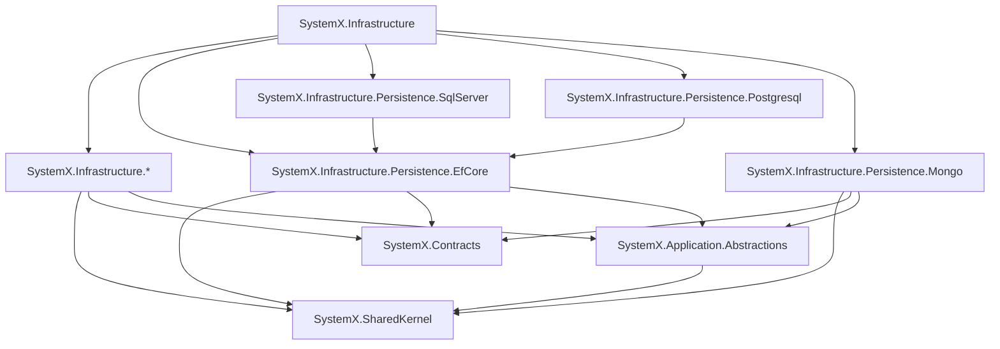

# SystemX.Nuget

Reusable building blocks and modular infrastructure libraries for .NET applications.

For architectural layering and package reference restrictions, refer to [AGENTS.md](AGENTS.md).

## Packages

| Package | Description | Installation |
|---|---|---|
| `SystemX.SharedKernel` | Core domain primitives, Entity, ValueObject, Result | `dotnet add package SystemX.SharedKernel` |
| `SystemX.Contracts` | Common DTOs, requests/responses, integration events | `dotnet add package SystemX.Contracts` |
| `SystemX.Application.Abstractions` | CQRS, Unit of Work, and repository abstractions | `dotnet add package SystemX.Application.Abstractions` |
| `SystemX.Infrastructure` | Metapackage aggregating infrastructure components | `dotnet add package SystemX.Infrastructure` |
| `SystemX.Infrastructure.Caching` | Caching abstractions and providers | `dotnet add package SystemX.Infrastructure.Caching` |
| `SystemX.Infrastructure.Cors` | Cross-Origin Resource Sharing extensions | `dotnet add package SystemX.Infrastructure.Cors` |
| `SystemX.Infrastructure.Cqrs` | CQRS messaging and mediator infrastructure | `dotnet add package SystemX.Infrastructure.Cqrs` |
| `SystemX.Infrastructure.HealthChecks` | Health checking infrastructure | `dotnet add package SystemX.Infrastructure.HealthChecks` |
| `SystemX.Infrastructure.Localization` | Internationalization and localization support | `dotnet add package SystemX.Infrastructure.Localization` |
| `SystemX.Infrastructure.Logging` | Structured logging integrations | `dotnet add package SystemX.Infrastructure.Logging` |
| `SystemX.Infrastructure.Messaging` | Asynchronous message broker abstractions | `dotnet add package SystemX.Infrastructure.Messaging` |
| `SystemX.Infrastructure.MultiTenancy` | Multi-tenancy isolation and tenant resolution | `dotnet add package SystemX.Infrastructure.MultiTenancy` |
| `SystemX.Infrastructure.Observability` | Metrics, tracing, and OpenTelemetry instrumentation | `dotnet add package SystemX.Infrastructure.Observability` |
| `SystemX.Infrastructure.Persistence.EfCore` | Base Entity Framework Core data access | `dotnet add package SystemX.Infrastructure.Persistence.EfCore` |
| `SystemX.Infrastructure.Persistence.Mongo` | MongoDB persistence integration | `dotnet add package SystemX.Infrastructure.Persistence.Mongo` |
| `SystemX.Infrastructure.Persistence.Postgresql` | PostgreSQL persistence provider using EF Core | `dotnet add package SystemX.Infrastructure.Persistence.Postgresql` |
| `SystemX.Infrastructure.Persistence.SqlServer` | SQL Server persistence provider using EF Core | `dotnet add package SystemX.Infrastructure.Persistence.SqlServer` |
| `SystemX.Infrastructure.RateLimiter` | Rate limiting and throttling components | `dotnet add package SystemX.Infrastructure.RateLimiter` |
| `SystemX.Infrastructure.Resilience` | Fault-tolerance and Polly resilience pipelines | `dotnet add package SystemX.Infrastructure.Resilience` |
| `SystemX.Infrastructure.Web` | ASP.NET Core web abstractions and middleware | `dotnet add package SystemX.Infrastructure.Web` |

## Dependency Architecture

