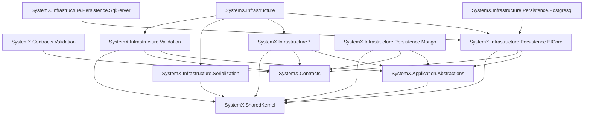

# SystemX.Nuget

Reusable building blocks and modular infrastructure libraries for .NET applications.

For architectural layering and package reference restrictions, refer to [AGENTS.md](AGENTS.md).

## 1. Overview and Packages

| Package | Purpose / Description | Installation |
|---|---|---|
| `SystemX.SharedKernel` | Domain and application building blocks shared by all apps: Entity, AggregateRoot, ValueObject, Enumeration, domain events, business rules, Result and Error, Guard, IClock, strongly-typed IDs, specifications, pagination types, audit/soft-delete/tenant markers. | `dotnet add package SystemX.SharedKernel` |
| `SystemX.Contracts` | The public data shapes exchanged between services and clients: Request/response DTOs, `PagedRequest`/`PagedResponse<T>`, integration events, error codes. Plain records. | `dotnet add package SystemX.Contracts` |
| `SystemX.Application.Abstractions` | The interfaces the application layer codes against: `ICommand`, `IQuery`, handler interfaces, dispatcher interfaces, `IUnitOfWork`, `IRepository<T>`, `IReadRepository<T>`, `ICurrentUser`, `ITenantContext`, `ICurrentCulture`, `ICacheService`, `IEventBus`. | `dotnet add package SystemX.Application.Abstractions` |
| `SystemX.Contracts.Validation` | FluentValidation validators for the shared DTOs in `SystemX.Contracts`. Lets clients and services validate the same DTOs without making `Contracts` depend on FluentValidation. | `dotnet add package SystemX.Contracts.Validation` |
| `SystemX.Infrastructure.Validation` | Runs FluentValidation on commands and queries through a handler decorator. Turns failures into `Result` with `ValidationError` (or throws `RequestValidationException`). Provides reusable rules for IDs. | `dotnet add package SystemX.Infrastructure.Validation` |
| `SystemX.Infrastructure.Serialization` | `System.Text.Json` support: converters and type converters for strongly-typed IDs and other SystemX types. | `dotnet add package SystemX.Infrastructure.Serialization` |
| `SystemX.Infrastructure` | Convenience package for the common Infrastructure packages. Contains NO source code, only references. | `dotnet add package SystemX.Infrastructure` |
| `SystemX.Infrastructure.Caching` | Cache abstraction implementations (memory, Redis), cache decorators and key conventions. | `dotnet add package SystemX.Infrastructure.Caching` |
| `SystemX.Infrastructure.Cors` | CORS policy setup with options. | `dotnet add package SystemX.Infrastructure.Cors` |
| `SystemX.Infrastructure.Cqrs` | Command/query dispatchers (no MediatR), handler registration and handler decorators (logging, transaction). | `dotnet add package SystemX.Infrastructure.Cqrs` |
| `SystemX.Infrastructure.HealthChecks` | Health check registration and endpoints (liveness, readiness), checks for the SystemX data and cache providers. | `dotnet add package SystemX.Infrastructure.HealthChecks` |
| `SystemX.Infrastructure.Localization` | Culture resolution, resource-based localization, `ICurrentCulture` implementation. | `dotnet add package SystemX.Infrastructure.Localization` |
| `SystemX.Infrastructure.Logging` | Structured logging setup (for example Serilog), enrichers (correlation id, tenant, user), log options. | `dotnet add package SystemX.Infrastructure.Logging` |
| `SystemX.Infrastructure.Messaging` | Event bus, integration-event publishing and consuming, outbox/inbox. | `dotnet add package SystemX.Infrastructure.Messaging` |
| `SystemX.Infrastructure.MultiTenancy` | Tenant resolution (header, claim, host), `ITenantContext` implementation, tenant query filters. | `dotnet add package SystemX.Infrastructure.MultiTenancy` |
| `SystemX.Infrastructure.Observability` | OpenTelemetry traces and metrics, exporters, instrumentation, naming conventions. | `dotnet add package SystemX.Infrastructure.Observability` |
| `SystemX.Infrastructure.Persistence.EfCore` | Provider-neutral EF Core base: `UnitOfWork`, generic repositories, specification evaluator, interceptors (audit, soft delete, tenant, domain-event dispatch), strongly-typed ID value converters. | `dotnet add package SystemX.Infrastructure.Persistence.EfCore` |
| `SystemX.Infrastructure.Persistence.Mongo` | MongoDB repositories, serializers and conventions. Independent from EF Core. | `dotnet add package SystemX.Infrastructure.Persistence.Mongo` |
| `SystemX.Infrastructure.Persistence.Postgresql` | PostgreSQL provider setup on top of `EfCore` (Npgsql, PostgreSQL specifics only). | `dotnet add package SystemX.Infrastructure.Persistence.Postgresql` |
| `SystemX.Infrastructure.Persistence.SqlServer` | SQL Server provider setup on top of `EfCore` (connection, options, SQL Server specifics only). | `dotnet add package SystemX.Infrastructure.Persistence.SqlServer` |
| `SystemX.Infrastructure.RateLimiter` | Rate-limiting policies (ASP.NET Core rate limiting) with options. | `dotnet add package SystemX.Infrastructure.RateLimiter` |
| `SystemX.Infrastructure.Resilience` | Retry, timeout, circuit breaker and bulkhead policies (Polly / Microsoft.Extensions.Resilience) with options. | `dotnet add package SystemX.Infrastructure.Resilience` |
| `SystemX.Infrastructure.Web` | ASP.NET Core pipeline setup: middleware, ProblemDetails, API versioning, Swagger, Result-to-HTTP mapping, JSON option wiring. | `dotnet add package SystemX.Infrastructure.Web` |

## 2. Dependency Architecture



## 3. Documentation

Links to detailed feature documentation and complete, compilable examples:

### SystemX.SharedKernel
- [Entity](docs/SystemX.SharedKernel/Entity.md)
- [AggregateRoot](docs/SystemX.SharedKernel/AggregateRoot.md)
- [DomainEvents](docs/SystemX.SharedKernel/DomainEvents.md)
- [ValueObject](docs/SystemX.SharedKernel/ValueObject.md)
- [Enumeration](docs/SystemX.SharedKernel/Enumeration.md)
- [BusinessRules](docs/SystemX.SharedKernel/BusinessRules.md)
- [Auditing](docs/SystemX.SharedKernel/Auditing.md)
- [SoftDelete](docs/SystemX.SharedKernel/SoftDelete.md)
- [MultiTenancy](docs/SystemX.SharedKernel/MultiTenancy.md)
- [ResultPattern](docs/SystemX.SharedKernel/ResultPattern.md)
- [ValidationResults](docs/SystemX.SharedKernel/ValidationResults.md)
- [Guard](docs/SystemX.SharedKernel/Guard.md)
- [Clock](docs/SystemX.SharedKernel/Clock.md)
- [StronglyTypedIds](docs/SystemX.SharedKernel/StronglyTypedIds.md)
- [Specifications](docs/SystemX.SharedKernel/Specifications.md)
- [Pagination](docs/SystemX.SharedKernel/Pagination.md)

### SystemX.Contracts
- [Pagination](docs/SystemX.Contracts/Pagination.md)

### SystemX.Contracts.Validation
- [ContractValidators](docs/SystemX.Contracts.Validation/ContractValidators.md)

### SystemX.Infrastructure.Validation
- [Validation](docs/SystemX.Infrastructure.Validation/Validation.md)
- [ValidationRules](docs/SystemX.Infrastructure.Validation/ValidationRules.md)

### SystemX.Infrastructure.Serialization
- [StronglyTypedIdJson](docs/SystemX.Infrastructure.Serialization/StronglyTypedIdJson.md)

## 4. How to publish packages to NuGet

### 4.1 One-Time Setup
1. **Reserve ID Prefix**: Log into [nuget.org](https://www.nuget.org), navigate to **Manage Organizations / Account > Package ID Prefixes**, and submit a reservation for `SystemX.*`.
2. **Create API Key**: Generate a new API key on nuget.org with **Push** permissions matching glob pattern `SystemX.*`.
3. **Save Repository Secret**: In your GitHub repository, navigate to **Settings > Secrets and variables > Actions** and create a secret named `NUGET_API_KEY` with your API key value.
4. **Environment**: The release workflow targets the `nuget` environment, allowing you to configure required deployment reviewers for safety.

### 4.2 Release Workflow (Automated)
1. Run the **Bump Version** workflow via GitHub Actions (`workflow_dispatch`), choosing `patch`, `minor`, `major`, or `custom`, and optionally flagging `prerelease`.
2. Alternatively, create and push an annotated git tag locally:
   ```bash
   ./scripts/release.sh 1.0.0
   ```
3. Pushing a `v*` tag triggers `.github/workflows/release.yml`, which restores, builds, tests, packs (`.nupkg` and `.snupkg`), pushes packages to nuget.org with `--skip-duplicate`, and publishes a GitHub Release with release notes and attached artifacts.

### 4.3 Manual Publish
To publish packages locally from the terminal:
```bash
dotnet pack -c Release -o artifacts
dotnet nuget push "artifacts/*.nupkg" --source https://api.nuget.org/v3/index.json --api-key <YOUR_API_KEY> --skip-duplicate
```

### 4.4 Publishing Rules
- Published package versions cannot be deleted (only unlisted). For test releases, use prerelease identifiers (`-preview.N`).
- Always update `CHANGELOG.md` under `## [Unreleased]` prior to releasing.

## 5. How to add the packages to your projects

### 5.1 Direct CLI Reference
Add packages directly using the .NET CLI:
```bash
dotnet add package SystemX.SharedKernel
dotnet add package SystemX.Contracts
# For prerelease versions:
dotnet add package SystemX.SharedKernel --prerelease
```

### 5.2 Central Package Management (CPM)
In repositories using Central Package Management (`Directory.Packages.props`):
```xml
<ItemGroup>
  <PackageVersion Include="SystemX.SharedKernel" Version="1.0.0" />
  <PackageVersion Include="SystemX.Contracts" Version="1.0.0" />
  <PackageVersion Include="SystemX.Infrastructure" Version="1.0.0" />
</ItemGroup>
```

In `.csproj`:
```xml
<ItemGroup>
  <PackageReference Include="SystemX.SharedKernel" />
</ItemGroup>
```

### 5.3 Metapackage vs Individual Packages
- Install `SystemX.Infrastructure` when you want a batteries-included infrastructure setup for an API or application.
- Install individual packages (e.g. `SystemX.Infrastructure.Caching`, `SystemX.Infrastructure.Validation`) to keep dependencies minimal. Note that provider-specific packages like `SystemX.Infrastructure.Persistence.SqlServer`, `SystemX.Infrastructure.Persistence.Postgresql`, and `SystemX.Contracts.Validation` must always be referenced individually.

### 5.4 Minimal Program.cs Setup
```csharp
using Microsoft.AspNetCore.Builder;
using Microsoft.Extensions.DependencyInjection;
using SystemX.Infrastructure.Serialization;
using SystemX.Infrastructure.Validation;

var builder = WebApplication.CreateBuilder(args);

// Register serialization and validation
builder.Services.AddSystemXSerialization();
builder.Services.AddSystemXValidation([typeof(Program).Assembly]);

var app = builder.Build();
app.Run();
```

### 5.5 Private and Local Feeds
To consume from GitHub Packages or Azure Artifacts, configure `nuget.config`:
```xml
<configuration>
  <packageSources>
    <add key="nuget.org" value="https://api.nuget.org/v3/index.json" />
    <add key="github" value="https://nuget.pkg.github.com/YOUR_ORG/index.json" />
  </packageSources>
</configuration>
```

For local testing:
```bash
dotnet nuget add source ./artifacts --name local
```

### 5.6 Updating Packages
Check for outdated packages:
```bash
dotnet list package --outdated
```

## 6. Contributing, Changelog, and License
- [AGENTS.md](AGENTS.md) - Architecture guidelines and contribution rules.
- [CHANGELOG.md](CHANGELOG.md) - Release history and version updates.
- [CONTRIBUTING.md](CONTRIBUTING.md) - Contribution guide and branching conventions.
- [LICENSE](LICENSE) - MIT License.
